<!-- Name -->

  <picture>
    <source media="(prefers-color-scheme: dark)" srcset="https://readme-typing-svg.demolab.com?font=JetBrains+Mono&weight=800&size=26&duration=2000&pause=&color=BD93F9&center=true&vCenter=true&repeat=false&width=520&height=40&lines=Muhammad+Fikri+Rouzan+Ash+Shidik">
    <source media="(prefers-color-scheme: light)" srcset="https://readme-typing-svg.demolab.com?font=JetBrains+Mono&weight=800&size=26&duration=2000&pause=&color=644AC9&center=true&vCenter=true&repeat=false&width=520&height=40&lines=Muhammad+Fikri+Rouzan+Ash+Shidik">
    
  </picture>

<!-- Roles -->

  <picture>
    <source media="(prefers-color-scheme: dark)" srcset="https://readme-typing-svg.demolab.com?font=JetBrains+Mono&weight=700&size=22&duration=3000&pause=1000&color=BD93F9&center=true&vCenter=true&width=380&height=35&lines=Data+Scientist;Full-Stack+Web+Developer">
    <source media="(prefers-color-scheme: light)" srcset="https://readme-typing-svg.demolab.com?font=JetBrains+Mono&weight=700&size=22&duration=3000&pause=1000&color=644AC9&center=true&vCenter=true&width=380&height=35&lines=Data+Scientist;Full-Stack+Web+Developer">
    
  </picture>

 

    <!-- Profile Views -->
    <picture>
      <source media="(prefers-color-scheme: dark)" srcset="https://komarev.com/ghpvc/?username=Fikri-Rouzan&style=for-the-badge&color=BD93F9">
      <source media="(prefers-color-scheme: light)" srcset="https://komarev.com/ghpvc/?username=Fikri-Rouzan&style=for-the-badge&color=644AC9">
      
    </picture>
    <!-- Followers -->
    <picture>
      <source media="(prefers-color-scheme: dark)" srcset="https://img.shields.io/github/followers/Fikri-Rouzan?style=for-the-badge&color=BD93F9">
      <source media="(prefers-color-scheme: light)" srcset="https://img.shields.io/github/followers/Fikri-Rouzan?style=for-the-badge&color=644AC9">
      
    </picture>
    <!-- Stars -->
    <picture>
      <source media="(prefers-color-scheme: dark)" srcset="https://img.shields.io/github/stars/Fikri-Rouzan?style=for-the-badge&color=BD93F9">
      <source media="(prefers-color-scheme: light)" srcset="https://img.shields.io/github/stars/Fikri-Rouzan?style=for-the-badge&color=644AC9">
      
    </picture>

---

## 📊 GitHub Stats

<table>
  <tr>
    <td valign="top" width="55%">
      <!-- GitHub Stats -->
      <picture>
        <source media="(prefers-color-scheme: dark)" srcset="https://github-stats-extended.vercel.app/api?username=Fikri-Rouzan&show_icons=true&theme=nightowl&include_all_commits=true&hide_border=true">
        <source media="(prefers-color-scheme: light)" srcset="https://github-stats-extended.vercel.app/api?username=Fikri-Rouzan&show_icons=true&theme=buefy&include_all_commits=true&hide_border=true">
        
      </picture>
      <!-- GitHub Streak -->
      <picture>
        <source media="(prefers-color-scheme: dark)" srcset="https://streak-stats.demolab.com?user=Fikri-Rouzan&theme=nightowl&hide_border=true">
        <source media="(prefers-color-scheme: light)" srcset="https://streak-stats.demolab.com?user=Fikri-Rouzan&theme=buefy&hide_border=true">
        
      </picture>
    </td>
    <td valign="top" width="45%">
      <!-- Top Languages -->
      <picture>
        <source media="(prefers-color-scheme: dark)" srcset="https://github-stats-extended.vercel.app/api/top-langs/?username=Fikri-Rouzan&langs_count=10&layout=compact&theme=nightowl&hide_border=true">
        <source media="(prefers-color-scheme: light)" srcset="https://github-stats-extended.vercel.app/api/top-langs/?username=Fikri-Rouzan&langs_count=10&layout=compact&theme=buefy&hide_border=true">
        
      </picture>
    </td>
  </tr>
</table>

---

## 🏆 GitHub Trophies

<!-- GitHub Trophies -->
<picture>
  <source media="(prefers-color-scheme: dark)" srcset="https://github-profile-trophy-unserori.vercel.app/?username=Fikri-Rouzan&theme=dracula&no-frame=true&row=1&column=9">
  <source media="(prefers-color-scheme: light)" srcset="https://github-profile-trophy-unserori.vercel.app/?username=Fikri-Rouzan&no-frame=true&row=1&column=9">
  
</picture>

---

## 🎯 GitHub Activity

<!-- GitHub Activity Graph -->
<picture>
  <source media="(prefers-color-scheme: dark)" srcset="https://raw.githubusercontent.com/Fikri-Rouzan/fikri-rouzan/activity-output/activity-graph-dark.svg">
  <source media="(prefers-color-scheme: light)" srcset="https://raw.githubusercontent.com/Fikri-Rouzan/fikri-rouzan/activity-output/activity-graph-light.svg">
  
</picture>

---

<!-- Pacman Contribution Graph -->
<picture>
  <source media="(prefers-color-scheme: dark)" srcset="https://raw.githubusercontent.com/Fikri-Rouzan/fikri-rouzan/pacman-output/pacman-contribution-graph-dark.svg">
  <source media="(prefers-color-scheme: light)" srcset="https://raw.githubusercontent.com/Fikri-Rouzan/fikri-rouzan/pacman-output/pacman-contribution-graph.svg">
  
</picture>
